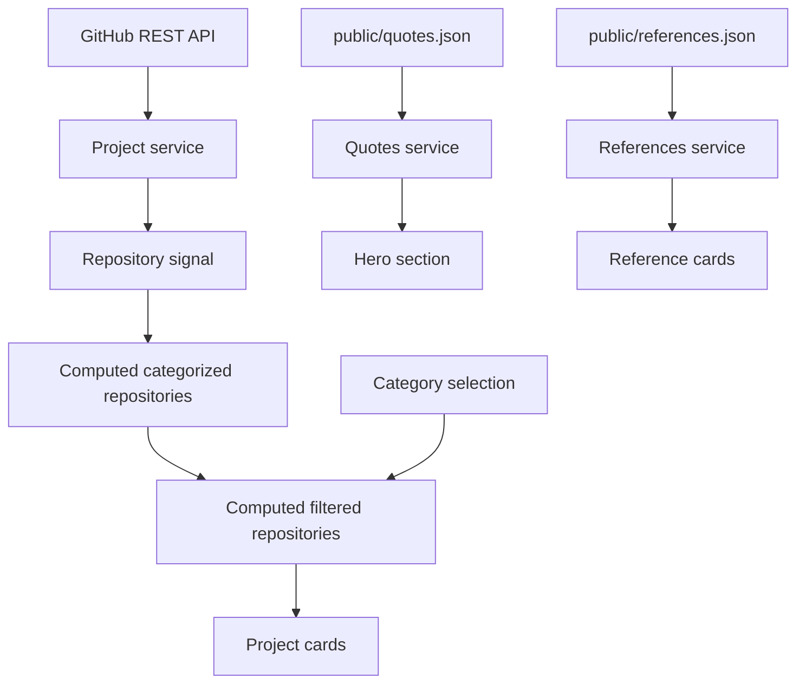
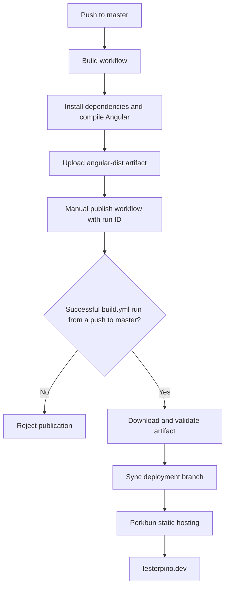

# Personal Portfolio — Lester Pino Barragan

[Live website](https://lesterpino.dev/) · [GitHub](https://github.com/lesteriv28)

A single-page portfolio built with **Angular 21**, **PrimeNG** and **Tailwind CSS v4** to showcase my engineering projects, professional experience and references. Beyond presenting my work, this project was a chance to learn more about frontend architecture, reactive programming, API integration and controlled software releases.

The site has five parts: a hero with a random Stoic quote, a project gallery pulled live from GitHub, a career timeline, a skills radar chart with a contact card, and testimonials from colleagues. It's prerendered to static HTML at build time, hosted on Porkbun, and released through a two-stage GitHub Actions pipeline that keeps building separate from publishing.

---

## Tech stack

| Area                       | Choice                                                            |
| -------------------------- | ----------------------------------------------------------------- |
| Framework                  | Angular 21 (standalone components, signals, zoneless), TypeScript |
| State management           | Angular signals, computed signals                                 |
| HTTP and asynchronous data | Angular HttpClient, RxJS, GitHub REST API                         |
| Rendering                  | Static prerendering via `@angular/ssr` + client hydration         |
| UI components              | PrimeNG 21 (Aura preset)                                          |
| Styling                    | Tailwind CSS v4 + `tailwindcss-primeui`, SCSS per component       |
| Charts                     | Chart.js (through PrimeNG `p-chart`)                              |
| Effects                    | `ngx-typed-writer` (typing animation), `@omnedia/ngx-starry-sky`  |
| Icons                      | Remix Icon (CDN), inline Lucide SVGs                              |
| Package manager            | Yarn 4 (via Corepack)                                             |
| CI/CD                      | GitHub Actions, GitHub CLI, jq, rsync                             |
| Hosting                    | Porkbun static hosting, custom domain                             |

---

## Features at a glance

| Feature                    | Implementation and rationale                                                                                                                                  |
| -------------------------- | ------------------------------------------------------------------------------------------------------------------------------------------------------------- |
| Dynamic project catalogue  | Retrieves repositories, descriptions, topics and languages through the GitHub REST API, so the portfolio and GitHub don't have to be kept in sync by hand. |
| Reactive project filtering | Signals and computed signals derive the visible projects from the repository data and the selected category (All, Web, Hardware or Software).                 |
| Technology badges          | Repository languages and topics give technical context without visitors having to open every repository.                                                     |
| Professional timeline      | Presents education, leadership and employment as a story in chronological order instead of repeating the résumé.                                            |
| Professional references    | Shows who I've worked with and what they have to say.                                                                                                         |
| Randomized quotes          | A dedicated service loads quotes from a local JSON file and exposes the selected quote through a signal.                                                      |
| Responsive interface       | SCSS, CSS Grid, container queries, fluid sizing and PrimeNG components adapt to different screen sizes.                                                       |
| Consistent visual theme    | The page looks the same whether the operating system is set to light or dark mode.                                                                            |
| Controlled publishing      | A successful build is packaged as an artifact and explicitly promoted to production by a separate workflow.                                                   |

---

## Application architecture

The application keeps presentation, data retrieval and derived state separate instead of putting everything in one component.



### Components and services

The page is built from independent sections: navigation, hero, projects, timeline, and skills/contact. Services handle data retrieval and related logic, so components can focus on rendering and interaction, and the code is easier to extend.

TypeScript interfaces describe the repository, quote and reference data. Explicit data shapes make it clear whether a value is a collection or a single object, and they make the transformations easier to follow. For example, `GithubRepo` → `Irepo` and `ReferralJson` → `Ireferral` map raw API and JSON fields into the shape the UI needs.

### Static prerendering instead of a running server

`angular.json` sets `"outputMode": "static"`, and `app.routes.server.ts` prerenders every route (`RenderMode.Prerender` on `**`). The build output is plain HTML/CSS/JS in `dist/webpage/browser`.
*Why:* a portfolio has no per-request data that needs a server. Prerendered HTML loads fast and can be indexed by search engines. It also works with static hosting like Porkbun, which has no Node.js runtime.

### Hydration with event replay

`provideClientHydration(withEventReplay())` reuses the prerendered DOM instead of re-rendering it.
*Why:* it avoids a visible flash when Angular boots. Event replay records clicks made before hydration finishes and replays them afterward, so an early click on "View Projects" isn't lost.

### Reactive state instead of manually synchronized arrays

An early version relied on mutable arrays and imperative filtering. I moved to a repository signal (`signal<Irepo[]>([])`) and `computed` values for the categorized and filtered repositories.

The repository collection stays the single source of truth. Changing the selected category changes the derived view; it doesn't overwrite the original data. When repository information changes (for example, when language tags arrive), Angular recomputes the dependent values automatically. This means there are never several separately mutable copies of the same collection to keep in sync.

Signals hold the reactive state, and HttpClient and RxJS still handle the asynchronous HTTP requests. A larger external state-management library wasn't needed at this project's scope.

`provideZonelessChangeDetection()` is enabled as well. Because state lives in signals, zone.js doesn't have to be shipped, and Angular only updates the views whose signals changed.

### Browser-only work runs in `afterNextRender` / `@defer`

Some code only works in a real browser, so it is kept out of the prerender step:

- The **quotes fetch** runs in `afterNextRender`. During prerender the relative `/quotes.json` request never completes and the build times out. Fetching in the browser also means each visitor gets a fresh random quote, instead of one quote frozen into the HTML at build time.
- The **starry sky background** is wrapped in `@defer (on immediate)`. The component measures the DOM in `ngAfterViewInit`, which fails on the server.
- The `body` background is set to `rgb(23 23 23)`, the sky's default color, so the page is already dark before the deferred sky loads. This prevents a white flash.
- **Scroll restoration** is set to `manual` and the window scrolls to the top after the first render. Anchor links and scroll animations made browsers restore a scroll position mid-page on reload, which was disorienting on a one-page site.

---

## Sections

### Hero ([hero-section](src/app/sections/hero-section/))

- A random Stoic quote from [public/quotes.json](public/quotes.json) is typed out with `ngx-typed-writer`.
- The portrait image has explicit `width`/`height` to avoid layout shift and `fetchpriority="high"` because it's the largest above-the-fold element.
- The layout uses `clamp()` and `min()` so the hero scales smoothly across screen sizes without many breakpoints.

### Projects — live from GitHub ([projects](src/app/sections/projects/), [project-service](src/app/services/project-service.ts))

- Repos are fetched from the GitHub REST API (`/users/lesteriv28/repos`). Each repo's `languages_url` is then fetched, and the keys of the returned object become the list of language tags.
  *Why:* the portfolio stays current without a second hand-maintained copy of every repository. A new public repo appears automatically.
- Cards render as soon as the repo list arrives, and language tags fill in as each request resolves (`repos.update(...)`). Visitors never wait on the slowest request.
- Repos are **auto-categorized** into Web / Hardware / Software by a heuristic over languages, topics and repo name. **Hardware is checked first** because FPGA and embedded projects often include JS/HTML tooling and would otherwise be misfiled as Web. Anything that matches neither category is Software.
- Category is derived in a `computed` instead of stored on the service. The raw GitHub data stays clean, and the classification rules live in one place.
- A PrimeNG `SelectButton` drives the filter signal. The grid goes from 3 to 2 to 1 columns at 1080px and 680px.

**Trade-off:** this design swaps manual upkeep for a dependency on an external API. GitHub rate limits, failed requests and the extra per-repo language requests are real limitations (see [Known limitations](#known-limitations)).

**Security consideration:** a static frontend can't store a personal access token securely. A privileged token must never be embedded in the Angular source or shipped in the browser bundle. If authenticated requests are ever needed, they should happen in a trusted build or backend environment.

### My Journey timeline ([about](src/app/sections/about/))

- Built on PrimeNG `p-timeline` with alternating layout. The entries are a typed `TimelineEvent[]` in the component.
- **Container queries** (`@container`, `@max-[640px]:`) collapse the timeline to a single column. Dates move into the card on narrow layouts.
  *Why:* the layout responds to the width of the timeline itself, not the viewport, so it works wherever the component is placed.
- Icons are **inlined Lucide SVGs** chosen with `@switch` on a typed union (`TimelineIcon`). This avoids an icon-library dependency for five icons, and a typo in an icon name is a compile error.
- Each stage gets a color from green to red (seed → rose), and the icons follow the same growth story.

### Skills, contact and references ([skills](src/app/sections/skills/), [contact](src/app/shared/contact/), [references](src/app/shared/references/))

- A Chart.js **radar chart** shows a self-assessment across eight areas, with a looping tension animation so it feels alive.
- The **contact card** types out a greeting. Clicking it opens a modal with phone, email and LinkedIn.
  *Why:* contact details stay one deliberate click away, not printed in the page body.
- **Testimonials** load from [public/references.json](public/references.json) and are typed out in message bubbles, each with a LinkedIn link and headshot.

### Content as data

Quotes and testimonials live in JSON files under [public/](public/) and are fetched at runtime.
*Why:* updating copy doesn't require touching component code, and the JSON is served as a static asset like everything else.

---

## Interface and design decisions

### PrimeNG and custom styling

PrimeNG provides reusable components for navigation, cards, category selection, the timeline, dialogs and charts. Using an existing component library let me focus on integration, state and application behavior instead of rebuilding every UI primitive.

- **PrimeNG Aura** components are themed for the dark design by overriding PrimeNG's **component CSS variables** (`--p-menubar-*`, `--p-tag-*`, `--p-dialog-*`, …) in each component's SCSS.
  *Why:* overriding the design tokens survives PrimeNG upgrades far better than overriding internal class names.
- **Tailwind v4** handles layout and utilities. Brand tokens are defined once in `@theme` in [styles.css](src/styles.css): `accent-red`, `accent-blue`, `accent-neon-blue` and two muted greys.
- Shared heading typography uses fluid `clamp()` sizes. The `section` max-width (1150px) is set globally so every section lines up.

### Theme consistency

During development, some component styles changed unexpectedly between the system's light and dark mode. Instead of maintaining two half-finished themes, I chose one consistent appearance for both settings in the first release. The colors PrimeNG would otherwise switch automatically are set explicitly through its CSS variables.

This reduces styling inconsistencies and the number of visual combinations to maintain. A dedicated light/dark theme can be added later if it's worth the extra work.

### Animation and filtering

Animations support the presentation of content and the transitions between project selections. `tailwindcss-primeui` supplies the `animate-enter` / `fade-in` / `slide-in-from-b-*` classes used with PrimeNG's `pAnimateOnScroll`. Animations use `[once]="true"` so content doesn't re-animate on every scroll pass.

Building the filter was also a way to understand how reactive state, Angular's rendering lifecycle and DOM insertion relate to each other. Scroll-triggered animations raised more questions about page reloads, scroll position and compatibility with prerendering and hydration (see [Browser-only work](#browser-only-work-runs-in-afternextrender--defer)).

Animations are an enhancement: the content and navigation should stay usable without them.

---

## Build and release architecture

The site was originally plain static HTML, CSS and JavaScript. Moving to Angular added a build step, so serving the source repository directly no longer gives you the compiled application.

Instead of changing hosting providers, I kept Porkbun and added a dedicated `deployment` branch that holds only the production-ready browser output. The workflows live in the repo root at `.github/workflows/`.



### Continuous integration — `build.yml`

Runs on every push to `master`. It sets up Node.js, enables Corepack, installs dependencies with `yarn install --immutable`, compiles the Angular application, and uploads `webpage/dist/webpage/browser/` as the `angular-dist` artifact. The workflow run ID identifies the specific build that can be published.

With an immutable install, an unexpected lockfile change makes the build fail instead of silently resolving a different dependency tree.

### Controlled publishing — `publish.yml`

Publishing is deliberately separate from building. The release workflow is triggered manually through `workflow_dispatch` and requires a `run_id` that identifies an existing build.

Before touching the deployment branch, it queries the GitHub Actions API with the GitHub CLI and validates the selected run with `jq`. Only a successful run of `build.yml` triggered by a push to `master` is accepted. A successful build from another branch or event doesn't authorize a publish.

The workflow then:

1. Downloads the selected `angular-dist` artifact.
2. Checks that the expected entry point (`public/index.html` in the staging directory) exists.
3. Checks out the `deployment` branch.
4. Syncs the compiled files with `rsync --delete`, removing obsolete generated assets.
5. Commits and pushes only if something changed, with the build run ID in the commit message (`Deploy build <run_id>`).

Deployments run in a dedicated `production-deployment` concurrency group with `cancel-in-progress: false`. Two publish jobs can't run at the same time, and a deployment already in progress is never cancelled halfway.

### Why separate the workflows?

- **Build once, publish the same artifact:** production gets the exact build that was selected, not a fresh compilation that could differ from it.
- **Explicit release control:** a source change or a successful build doesn't automatically become a production release.
- **Traceability:** each deployment commit references the workflow run that produced it.
- **Separation of responsibilities:** `master` holds source code; `deployment` holds generated static assets.
- **Hosting independence:** the frontend can use Angular while the host only has to serve static files.

Static hosting has no Node.js server at runtime. That's why the deployment uses prerendered, browser-ready output rather than runtime Angular SSR.

---

## Local development

**Prerequisites:** Node.js (CI uses v26) and Corepack.

```bash
git clone https://github.com/lesteriv28/profile.git
cd profile/webpage
corepack enable
yarn install --immutable
yarn start          # dev server at http://localhost:4200
```

| Script       | What it does                                          |
| ------------ | ----------------------------------------------------- |
| `yarn start` | Dev server with live reload                           |
| `yarn build` | Production build + prerender → `dist/webpage/browser` |
| `yarn watch` | Development build in watch mode                       |
| `yarn test`  | Unit tests (Karma + Jasmine)                          |

To preview the production build locally, serve the static folder with any file server, for example:

```bash
yarn build
npx serve dist/webpage/browser
```

## Publishing a release

1. Push the source changes to `master`.
2. Confirm the matching **Site Deployment** (build) workflow completed successfully.
3. Copy that build's run ID from GitHub Actions.
4. Open **Actions → Publish Site → Run workflow** and enter the run ID.
5. Confirm the publish workflow succeeds and Porkbun serves the new deployment.

The `deployment` branch is generated output. Don't make source changes there.

## Project structure

```
src/
├── index.html, styles.css          # Global shell, Tailwind theme tokens
├── main.ts / main.server.ts        # Browser and prerender entry points
└── app/
    ├── app.ts / app.html           # Root: navbar, deferred starry sky, sections
    ├── app.config*.ts              # Providers: zoneless, hydration, PrimeNG, HttpClient
    ├── app.routes.server.ts        # Prerender all routes
    ├── layout/navbar/              # Sticky PrimeNG menubar with anchor links + resume
    ├── sections/
    │   ├── hero-section/           # Intro + typed quote
    │   ├── projects/               # GitHub-driven, filterable project grid
    │   ├── about/                  # Career timeline
    │   └── skills/                 # Radar chart + contact + references
    ├── shared/
    │   ├── contact/                # Contact card + dialog
    │   └── references/             # Testimonial cards
    └── services/                   # Project (GitHub API), quotes, references
public/
├── quotes.json, references.json    # Editable content
└── *.jpg / *.png / *.ico           # Portraits, headshots, favicon
```

## Updating content

- **Quotes:** edit [public/quotes.json](public/quotes.json) (`{ "quote", "author" }`).
- **Testimonials:** edit [public/references.json](public/references.json) and add the headshot image to `public/`.
- **Timeline:** edit the `events` array in [about.ts](src/app/sections/about/about.ts). Set `featured: true` to highlight an entry.
- **Projects:** nothing to edit. Add GitHub topics (e.g. `fpga`, `embedded`, `web`, `react`) to a repo to control which category it lands in.
- **Skills chart:** edit `data.datasets[0].data` in [skills.ts](src/app/sections/skills/skills.ts).

## Known limitations

- The project section makes 1 + N unauthenticated GitHub API requests per visit. GitHub limits these to 60 per hour per IP, so a visitor who reloads often can hit the limit and see an empty or partially tagged grid.
- [server.ts](src/server.ts) (Express SSR server) is left over from the Angular SSR scaffold. With `outputMode: "static"` the deployed site doesn't use it.

## Lessons learned

- Reactive state is easier to maintain when derived data has a single source of truth.
- Observables and signals solve related but different problems. Asynchronous HTTP requests don't require managing all application state imperatively.
- Component libraries speed up development, but you still need to understand how their styling and theming work.
- Building an application and deploying it are separate engineering problems.
- Release eligibility, artifact validation and deployment concurrency deserve explicit attention, even in a small personal project.
- Shipping a coherent first version is worth more than endlessly refining secondary features.

## Future improvements

- Fetch and cache public repository metadata at build time to cut browser-side GitHub requests and avoid rate limits.
- Improve error states for failed or rate-limited API requests.
- Condense text-heavy sections and improve the visual hierarchy of project descriptions.
- Feature selected projects with deeper technical case studies.
- Expand automated testing for project filtering and release validation.
- Revisit dedicated light and dark themes, and do further accessibility and responsive-layout checks.

## Author

**Lester Pino Barragan** — Computer Engineer and Full-Stack Developer

- Portfolio: [lesterpino.dev](https://lesterpino.dev/)
- GitHub: [github.com/lesteriv28](https://github.com/lesteriv28)
- LinkedIn: [/in/lesterpino](https://www.linkedin.com/in/lesterpino/)
