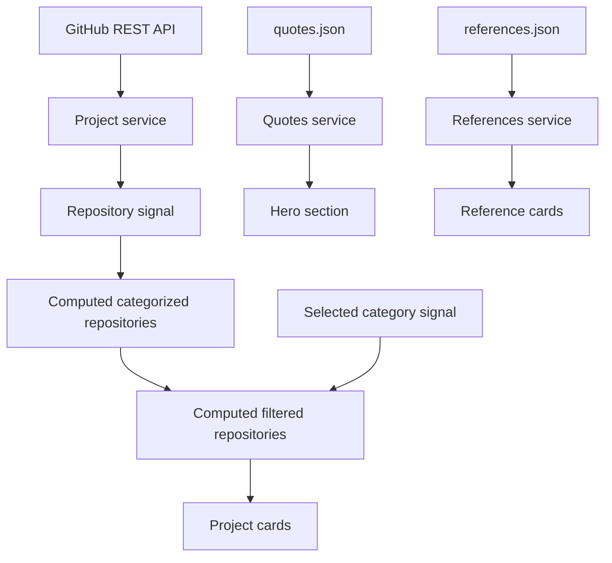
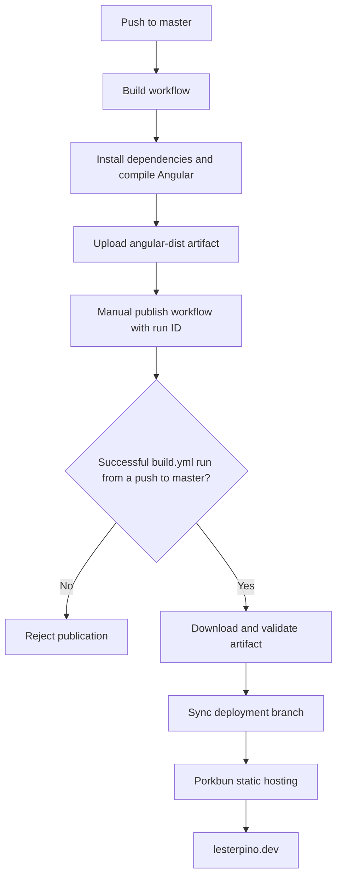

# Personal Portfolio — Lester Pino Barragan

[Live website](https://lesterpino.dev/) · [GitHub](https://github.com/lesteriv28) · [LinkedIn](https://www.linkedin.com/in/lesterpino/)

A single-page portfolio built with **Angular 21, PrimeNG and Tailwind CSS v4** to showcase my engineering projects, professional experience and references. The application combines a GitHub-driven project catalogue, reactive state management and static prerendering with a two-stage CI/CD pipeline for controlled production releases.

## Features

- **Dynamic project catalogue:** retrieves repository metadata, topics and programming languages directly from GitHub, with automatic categorization and interactive filtering.
- **Professional timeline:** presents education, leadership and industry experience through a responsive chronological layout.
- **Skills and references:** an interactive skills radar chart, contact dialog and testimonials from colleagues.
- **Responsive interface:** fluid typography, adaptive layouts, scroll animations and a consistent visual theme across system color preferences.
- **Static hosting and controlled publishing:** prerendered Angular output hosted on Porkbun, with explicit promotion of validated build artifacts to production.

## Technology stack

| Area | Technologies |
| --- | --- |
| Framework | Angular 21, TypeScript, standalone components |
| State and data | Angular Signals, RxJS, HttpClient, GitHub REST API |
| Rendering | Static prerendering, client hydration, zoneless change detection |
| UI and styling | PrimeNG 21 (Aura), Tailwind CSS v4, SCSS, Chart.js |
| Build tooling | Yarn 4, Corepack |
| CI/CD | GitHub Actions, GitHub CLI, jq, rsync |
| Hosting | Porkbun static hosting |

## Architecture and engineering decisions

The application separates presentation, data retrieval and derived state. Services handle external requests and data transformations, while standalone components render the individual sections. TypeScript interfaces define the shape of repository, quote and reference data.



### Reactive state management

An early implementation relied on mutable arrays and imperative filtering. I replaced it with a repository signal (`signal<Irepo[]>([])`) and computed values for categorization and filtering.

The repository collection remains the single source of truth. Changing the selected category or updating repository metadata automatically recalculates the relevant derived state without maintaining separate mutable copies of the data.

Signals manage application state, while HttpClient and RxJS handle asynchronous requests. Angular's built-in reactive primitives are sufficient for the scope of this project without introducing an external state-management library.

### GitHub integration and categorization

Repository metadata is retrieved from the GitHub REST API. Additional requests to each repository's `languages_url` provide language tags, which populate progressively as requests resolve. This allows the project cards to render without waiting for every language request to finish.

Repositories are categorized into **Web, Hardware or Software** using their languages, topics and names. Hardware is evaluated first because embedded and FPGA projects can contain web-based tooling and would otherwise risk being classified as Web. Repositories that match neither category default to Software.

Classification is derived rather than stored on the original repository objects, keeping the retrieved data separate from presentation rules. This approach reduces manual portfolio maintenance but introduces a dependency on GitHub API availability and rate limits.

### Static prerendering and hydration

The application uses Angular's static output mode and prerenders routes at build time. A portfolio does not require a dedicated application server for each request, so the generated HTML, CSS and JavaScript can be served directly through the existing Porkbun hosting environment.

Client hydration with event replay preserves the prerendered DOM and supports interactions made before hydration completes. Dynamic repository data is retrieved at runtime.

Browser-dependent operations are handled separately: randomized quotes are loaded in `afterNextRender`, and the starry background is deferred because it depends on DOM measurements. This avoids executing browser-specific behavior during prerendering.

### Interface and content management

PrimeNG components are customized through design tokens and component-level SCSS, while Tailwind handles layout and utility styling. A unified theme prevents inconsistent component colors between system light and dark preferences. Container queries and fluid sizing adapt layouts to the available space.

Quotes and testimonials are loaded from JSON assets, separating editable content from component logic.

## Build and release pipeline

Moving from plain HTML, CSS and JavaScript to Angular introduced a compilation step. Rather than migrating hosting providers, I kept Porkbun and separated application source code from generated production assets using a dedicated `deployment` branch.



### Continuous integration — `build.yml`

Triggered by pushes to `master`, the workflow enables Corepack, installs dependencies with `yarn install --immutable`, compiles the application and uploads the browser output as the `angular-dist` artifact. The immutable install prevents unexpected lockfile changes, and the workflow run ID identifies the resulting build.

### Controlled publishing — `publish.yml`

Publishing is triggered manually with a required `run_id`. Using the GitHub CLI and `jq`, the workflow verifies that the selected run is a successful execution of `build.yml` triggered by a push to `master`.

Once validated, it downloads the artifact, checks for the expected HTML entry point, syncs the compiled files to the `deployment` branch using `rsync --delete`, and commits changes with the build run ID for traceability. The synchronization removes obsolete generated assets.

A dedicated `production-deployment` concurrency group prevents overlapping active deployments. Setting `cancel-in-progress: false` prevents a competing publish run from interrupting an active deployment.

### Why separate building from publishing?

| Decision | Rationale |
| --- | --- |
| Artifact promotion | Publish the exact output of a selected successful build rather than compiling again. |
| Manual release trigger | A successful build does not automatically become a production release. |
| Run and artifact validation | Reject builds that do not meet release eligibility requirements. |
| Deployment commit traceability | Link production assets to the workflow run that generated them. |
| Dedicated deployment branch | Keep generated assets separate from application source code. |

To publish, confirm that the build workflow succeeded, copy its run ID, and run **Actions → Publish Site → Run workflow** with that ID. Once publishing succeeds, verify the live website. The `deployment` branch should not be edited manually.

## Local development

**Prerequisites:** Node.js (CI uses v26) and Corepack.

```bash
git clone https://github.com/lesteriv28/profile.git
cd profile/webpage
corepack enable
yarn install --immutable
yarn start
```

The development server runs at `http://localhost:4200`.

| Command | Description |
| --- | --- |
| `yarn start` | Start the development server with live reload |
| `yarn build` | Build and prerender the production application |
| `yarn watch` | Run a development build in watch mode |
| `yarn test` | Run unit tests |

To preview the production output locally:

```bash
yarn build
npx serve dist/webpage/browser
```

## Known limitations and future improvements

- **GitHub API usage:** the catalogue makes one request for the repository list plus one language request per repository. Unauthenticated requests are rate-limited, which can result in an incomplete or empty catalogue. Build-time caching could reduce runtime requests and improve reliability. Privileged API tokens must not be shipped in the browser bundle.
- **Error handling and testing:** improve API failure states and expand automated coverage for project filtering and release validation.
- **Content and accessibility:** condense text-heavy sections, feature selected projects with deeper technical case studies, and continue accessibility and responsive-layout testing.
- **Theming:** revisit dedicated light and dark themes in a future release.

---

Built by **Lester Pino Barragan** — Computer Engineer and Full-Stack Developer.
